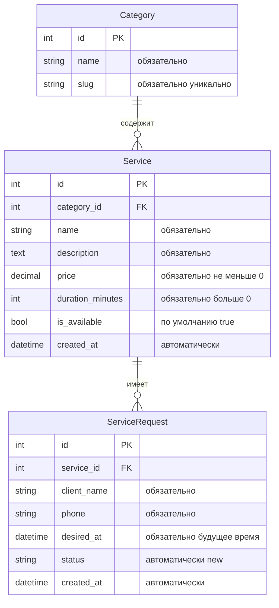

# Каталог услуг — серверная часть

Учебный проект на Django REST Framework. База SQLite. В папке `backend` находятся приложение, настройки и миграции.

## Запуск в Windows PowerShell

Из корня проекта:

```powershell
py -m venv .venv
.\.venv\Scripts\Activate.ps1
pip install -r requirements.txt
$env:DJANGO_SECRET_KEY = 'придумайте-свой-локальный-ключ'
cd backend
python manage.py migrate
python manage.py seed_data
python manage.py createsuperuser
python manage.py runserver
```

На Linux/macOS вместо активации используется `source .venv/bin/activate`, а переменная задаётся командой `export DJANGO_SECRET_KEY='свой-ключ'`. Ключ не включён в репозиторий. Для каждого нового терминала его необходимо задать заново. Это учебная настройка; при развёртывании нужно отключить DEBUG и изменить настройки безопасности.

Команда `seed_data` добавляет 4 категории, 15 услуг (одна недоступна) и 8 заявок в пустую базу; повторно данные не дублируются. Админ-панель: http://127.0.0.1:8000/admin/. Маршруты и примеры запросов описаны в [API.md](API.md).

Тесты из папки `backend`:

```powershell
python manage.py test
```

## Схема данных



Категория содержит много услуг, услуга может иметь много заявок. Удаление связанной категории или услуги запрещено. Статусы: `new`, `in_progress`, `done`, `cancelled`.
